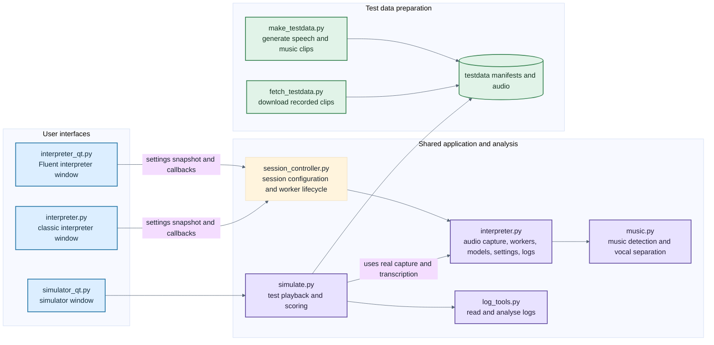
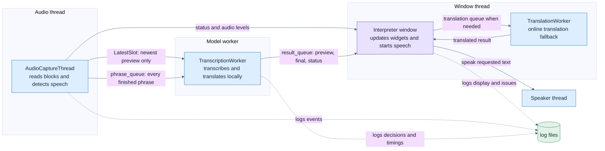
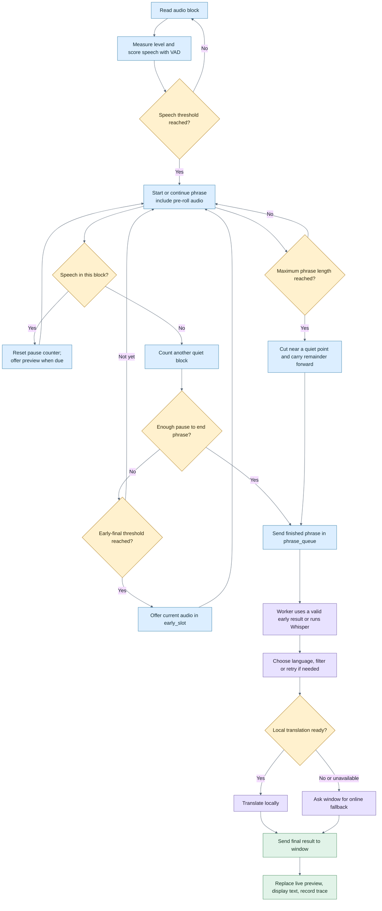
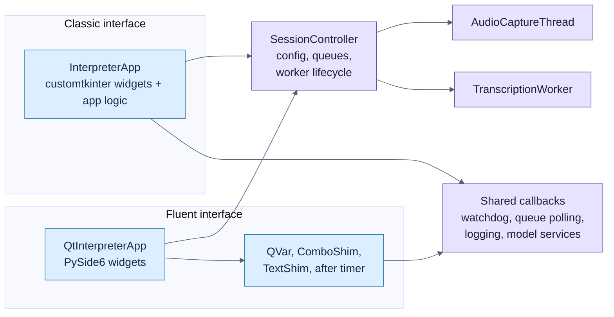
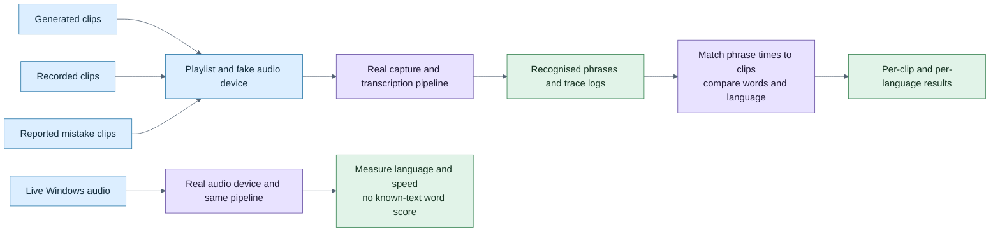

# Visual guide to the project

These diagrams answer different questions, so start with the one you need:

| Question | Diagram |
| --- | --- |
| Which part owns each responsibility? | Project structure |
| How do background threads communicate? | Message flow |
| How does audio become a phrase? | Phrase lifecycle |
| How does the Qt window reuse the app logic? | Two interfaces, shared core |
| How does the simulator test the real pipeline? | Test design |

In VS Code, open this file and press **Ctrl+Shift+V**. Mermaid diagrams render
with the recommended Markdown Mermaid extension ([VSCODE.md](VSCODE.md)). The
source is plain text between the `mermaid` fences, so it remains readable in
any editor.

---

## 1. Project structure: who owns what?

**How to read it:** an arrow means “uses” or “hands work to,” as labelled.
The two interpreter windows share the same application logic. The simulator
also uses that logic, with test audio supplied in place of a physical input.

**Code trail:** start at `QtInterpreterApp` or `InterpreterApp`, follow its
settings snapshot into `SessionController.start()` in `session_controller.py`,
then follow the worker constructors in `interpreter.py`. For tests, start at
`run()` in `simulate.py` and follow `build()`.

---

## 2. Message flow: threads and hand-offs

The **window thread owns the widgets**. Background workers send messages for
the window to handle. A `LatestSlot` is a one-item mailbox: a newer preview
replaces a stale pending preview. The `phrase_queue` keeps finished phrases,
because each one must still be processed. The window polls its result queue and
updates the display on the UI thread.

**Code trail:** search for `LatestSlot`, `phrase_queue`, `result_queue`, and
`_poll_queue` in `interpreter.py`. Follow each message from its `.put(...)` to
the matching `.get...(...)`.

---

## 3. Phrase lifecycle: audio blocks to final text

Music mode changes the pause and maximum-length rules and can separate the
voice from instruments before recognition. The early slot is speculative: if
speech resumes, that early audio no longer represents the finished phrase.
The final queue remains the authoritative hand-off for a completed phrase.

**Code trail:** `AudioCaptureThread.run()` handles blocks and boundaries;
`_flush()` sends a finished phrase; `TranscriptionWorker.run()` consumes work.
Search for `_detect_auto()` to study language selection.

---

## 4. Two interfaces, one shared core

Both interfaces pass a settings snapshot and UI callbacks to the controller.
The controller owns the worker queues and runtime threads; the views own their
widgets and display updates. A few older callbacks remain shared during the
ongoing UI separation.

**Code trail:** read the module guide at the top of `interpreter_qt.py`, then
read `SessionController` in `session_controller.py`, then follow the view's
callback bindings in each UI class.

---

## 5. Test design: repeatable input, real processing

Known-text clips let the simulator measure word error rate. Live audio has no
reference transcript, so it can report timing and detected language, but not
whether every word was correct. This is why a controlled before-and-after run
is more informative than judging one result in isolation.

**Code trail:** `build()` connects the real workers to a fake or live audio
source; `score()` associates phrase timings with clips; `log_tools.py` analyses
the resulting traces.
