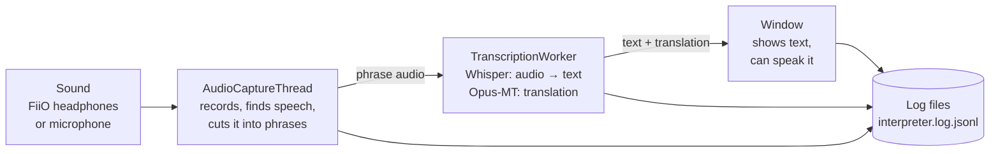
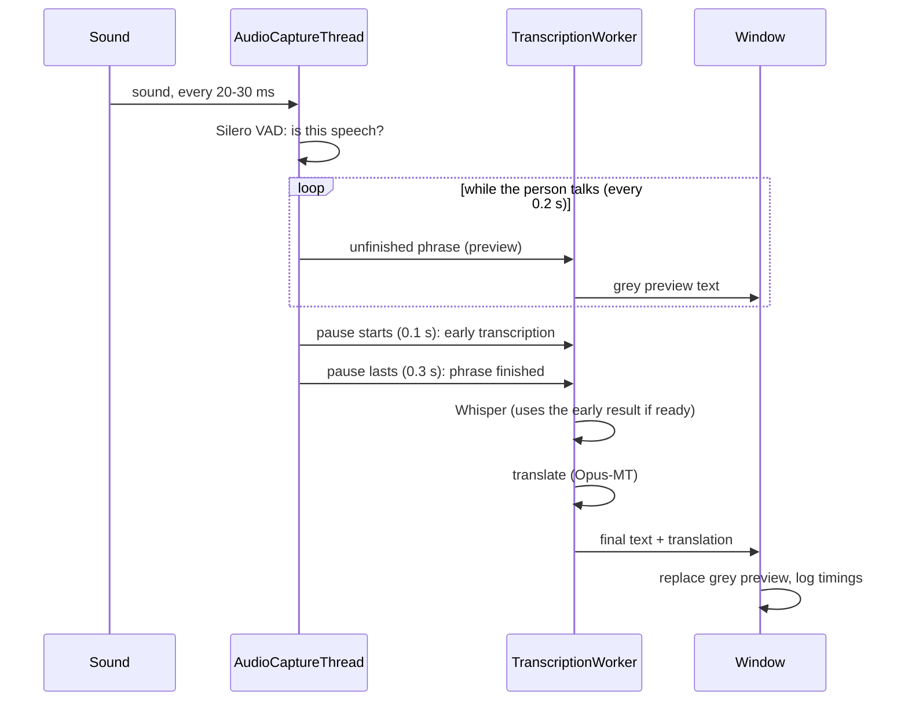
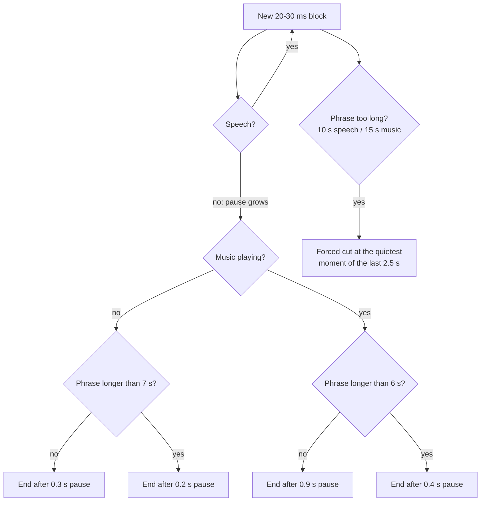
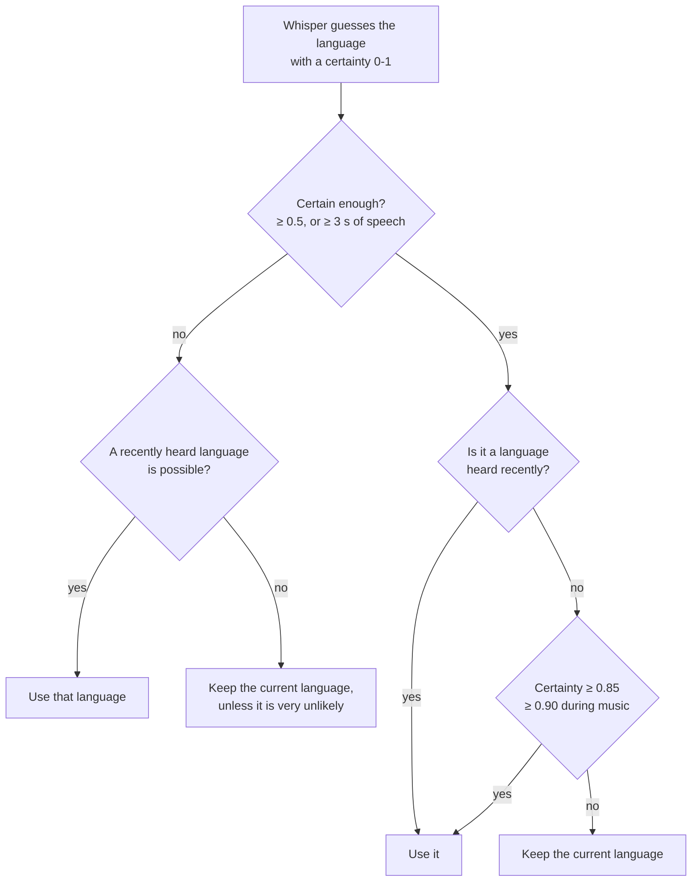
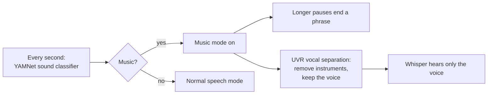
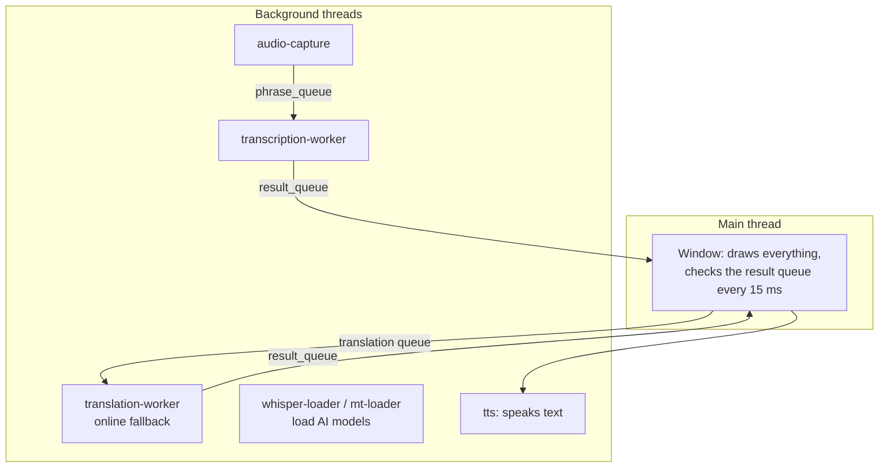
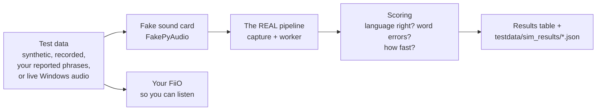
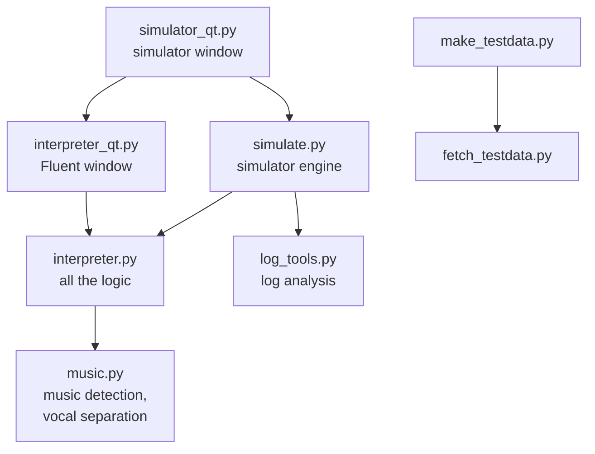

# Map of the program

Pictures of how the parts fit together.
To see the diagrams: open this file and press **Ctrl+Shift+V**
(needs the "Markdown Preview Mermaid Support" extension, see [VSCODE.md](VSCODE.md)).

---

## 1. The big picture

- **Left to right** is the path of the sound.
- Each box is a **thread**: it runs at the same time as the others.
- They pass work along through **queues** (like mailboxes).

---

## 2. A phrase's journey

What happens to one sentence, step by step.

---

## 3. Where a phrase ends

The log line of every phrase says which rule ended it (`end_rule`).

---

## 4. Choosing the language (Auto-detect)

The log line says why (`lang_reason`).

---

## 5. Music mode

The voice is separated in 6-second chunks **while the singing is still going**, so little is left to do when the phrase ends.

---

## 6. The threads

**Rule:** only the main thread may touch the window. Everything else sends messages.

---

## 7. The simulator

The simulator uses the **same code** as the app; only the sound card is replaced.

---

## 8. Which file uses which

