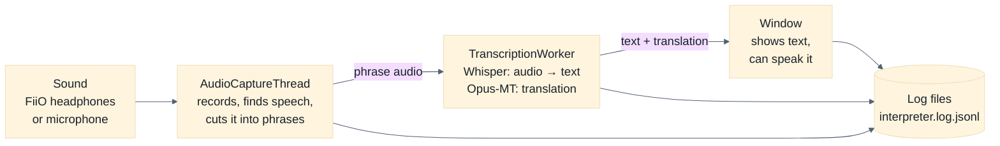
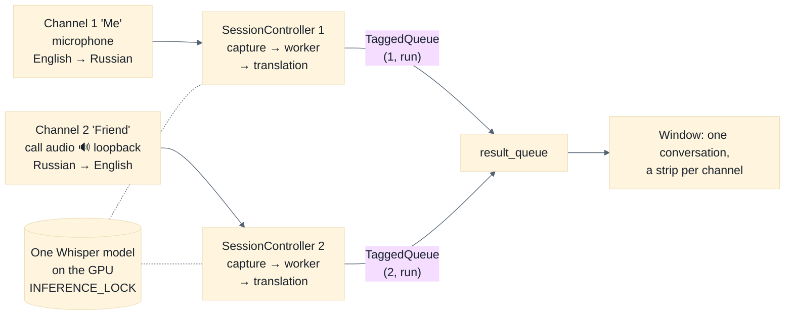
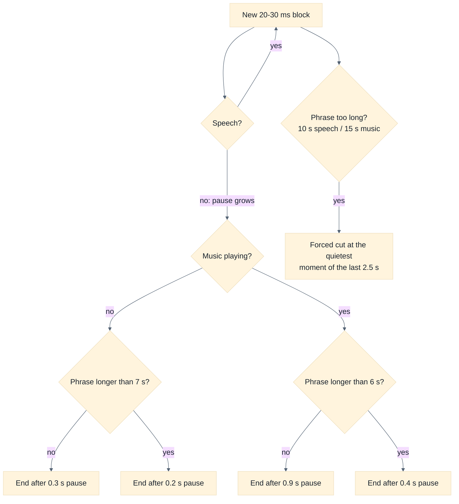
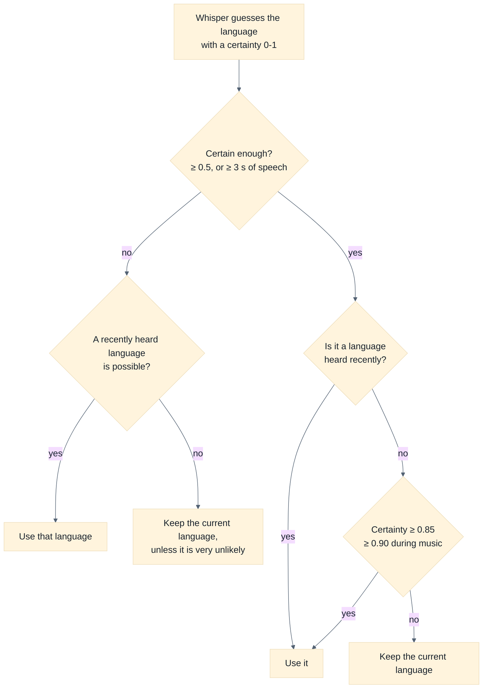
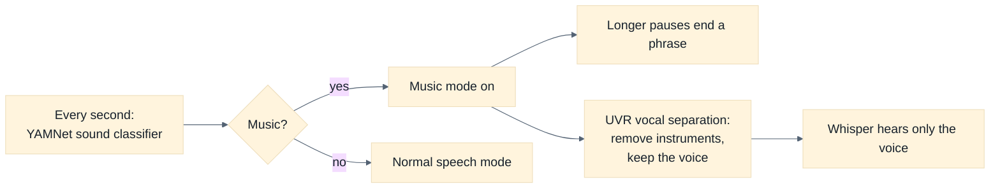
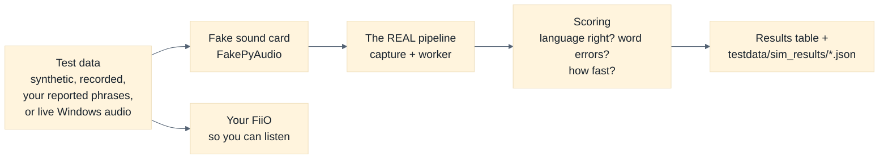
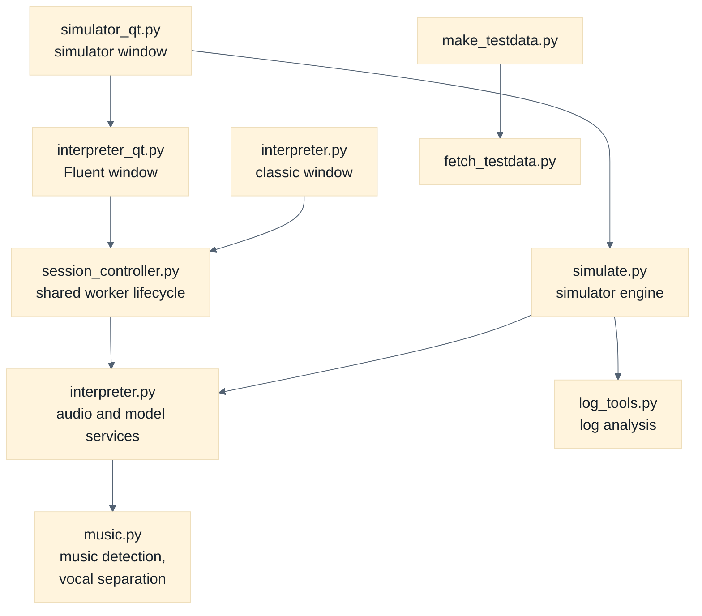

# Map of the program

Quick overview diagrams. For more detailed pictures of module responsibilities,
thread hand-offs, phrase lifecycle, interface reuse, and testing, see
[FLOWCHARTS.md](FLOWCHARTS.md). To view Mermaid diagrams, open a Markdown file
and press **Ctrl+Shift+V** (see [VSCODE.md](VSCODE.md)).

---

## 1. The big picture



- **Left to right** is the path of the sound.
- The capture and transcription boxes are background threads; the window runs
  on the main thread. Sound and logs are data sources and storage, not threads.
- The Fluent window runs this path **twice at once**, one per channel (see
  [Two channels](#1a-two-channels-fluent-window)). The classic window runs it
  once, for the device of the selected mode.

## 1a. Two channels (Fluent window)



- Each channel has its own device, languages, sensitivity, Mute, Speak and
  output device. The model and preview model are shared.
- Every message from a channel arrives labelled `(channel, run id)`. The run id
  changes when a channel restarts, so late messages from a stopped pipeline are
  recognised and ignored.
- PortAudio may only be started or stopped by one thread at a time
  (`portaudio_start()` / `portaudio_stop()`, `PORTAUDIO_LOCK`): with two
  channels, overlapping starts crashed the app.
- Work passes between threads through **queues** (like mailboxes). The detailed
  [message flow](FLOWCHARTS.md#2-message-flow-threads-and-hand-offs) shows which
  messages use a replaceable preview slot and which use queues.

---

## 2. A phrase's journey

What happens to one sentence, step by step.

```mermaid
%%{init: {"theme": "base", "themeVariables": {"fontSize": "18px", "fontFamily": "Segoe UI, Arial, sans-serif", "lineColor": "#536273", "primaryTextColor": "#17212b"}, "sequence": {"actorFontSize": 18, "messageFontSize": 18, "noteFontSize": 16, "actorMargin": 48, "messageMargin": 32}}}%%
sequenceDiagram
    participant S as Sound
    participant C as AudioCaptureThread
    participant W as TranscriptionWorker
    participant UI as Window
    S->>C: audio blocks; VAD scores 32 ms frames at 16 kHz
    C->>C: Silero VAD: is this speech?
    loop while the person talks (every 0.2 s)
        C->>W: unfinished phrase (preview)
        W->>UI: grey preview text
    end
    C->>W: pause starts (0.1 s): offer early audio in a replaceable slot
    C->>W: pause lasts (0.3 s): finished phrase enters phrase_queue
    W->>W: Whisper (reuse early result if still valid, otherwise transcribe)
    W->>W: translate (Opus-MT)
    W->>UI: final text + translation
    UI->>UI: replace grey preview, log timings
```

---

## 3. Where a phrase ends



The log line of every phrase says which rule ended it (`end_rule`).

---

## 4. Choosing the language (Auto-detect)



The log line says why (`lang_reason`).

---

## 5. Music mode



The voice is separated in 6-second chunks **while the singing is still going**, so little is left to do when the phrase ends.

---

## 6. The threads

```mermaid
%%{init: {"theme": "base", "themeVariables": {"fontSize": "18px", "fontFamily": "Segoe UI, Arial, sans-serif", "lineColor": "#536273", "primaryTextColor": "#17212b"}, "flowchart": {"nodeSpacing": 52, "rankSpacing": 64, "htmlLabels": true, "curve": "basis"}}}%%
flowchart TB
    subgraph Main thread
        UI[Window: draws everything,<br/>checks the result queue every 15 ms]
    end
    subgraph Background threads, one set per channel
        CAP[audio-capture-Me / -Friend]
        TW[transcription-worker-Me / -Friend]
        TR[translation-worker<br/>online fallback]
        TTS[tts: speaks text]
    end
    WL[whisper-loader / mt-loader<br/>load AI models, shared]
    CAP -- phrase_queue --> TW
    TW -- result_queue --> UI
    UI -- translation queue --> TR
    TR -- result_queue --> UI
    UI --> TTS
```

**Rule:** only the main thread may touch the window. Everything else sends messages.

---

## 7. The simulator



The simulator uses the **same code** as the app; only the sound card is replaced.

---

## 8. Which file uses which


